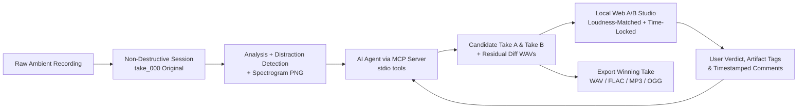

# AmbientSound

**MCP-driven ambient audio cleanup and loudness-matched A/B listening studio.**

AmbientSound is an open-source (`Apache-2.0`) audio restoration toolkit built specifically for **field recordings and ambient soundscapes** (rain, wind, forests, cafés, urban rooms, ocean surf). Unlike speech-only denoisers that treat ambient background texture as noise to be erased, AmbientSound treats the ambient bed as the **desired signal** and targets **localized distractions**—hum, wind rumble, clicks, stray horns, voices, or handling bumps—while keeping the surrounding soundscape natural.

An AI model interacts with AmbientSound over the **Model Context Protocol (MCP)** to inspect psychoacoustic metrics, spectrograms, and detected distraction spans, propose multiple cleanup filter chains (non-destructive *takes*), and spin up **loudness-matched A/B listening tests** in a local Web Audio studio where you choose the winner and leave feedback for the next tuning pass.

---

## Core Workflow



## Key Features (v0.4.0)

- **16 Ambient-First CPU DSP Filters (Streaming & In-Memory, Permissive Stack):**
  - `highpass_rumble`: Zero-phase Butterworth high-pass for wind/traffic rumble.
  - `dehum_notch` & `drone_notch`: Zero-phase cascaded notches for 50/60 Hz mains hum and persistent machine-drone frequencies (`30–8000 Hz`).
  - `declick_impulse`: MAD spike detection + PCHIP sample interpolation for mic clicks/pops (with `texture_tick_rate_per_min` organic tick telemetry so insect/bee micro-ticks aren't stripped inadvertently).
  - `spectral_denoise`: Linked-stereo soft STFT spectral gate/Wiener denoiser.
  - `spectral_match_suppress`: Per-bin `n_fft=4096` STFT adaptive excess suppression against clean surrounding bed percentiles with optional clean-context texture fill — attenuates passing cars, exhaust harmonics, and temporary overlapping tones without carving hollow gaps into nearby bee/nature frequencies.
  - `band_attenuate`: Feathered time-frequency attenuation supporting `"adaptive"`, `"swell"`, `"flat"`, up to `5 s` fades, and batched multi-span lists (`spans`).
  - `ambience_patch`: Replaces one or many distracted spans with non-repeating, event-screened clean donor audio using RMS + 2-band tilt matching, equal-power crossfades (`crossfade_ms` up to `5000 ms`), and `donor_quality` telemetry.
  - `trim_range`, `cut_regions`, `fade_edges`, & `gain`: Extract ranges (with timeline tracking), cut bad stretches with equal-power crossfades, add smooth start/end fades, and apply clean linear dB gain staging before compression.
  - `parametric_eq`, `soft_compress`, `loudness_normalize`, & `true_peak_limiter`: Tone shaping (`lowshelf` warmth / `highshelf` air), gentle RMS compression, peak-limited (`limit_peaks=True`) 2-pass streaming BS.1770 LUFS leveling (`-14 LUFS` YouTube/ASMR ready), and lookahead limiting.
- **Large-File Streaming, Zero-Copy Sessions & Continuous Multi-File Splits (`> 120 s` / 2 GB+):** Supports `copy_source=False` in-place WAV referencing, `compact_metrics=True` transport, RF64 temp stages with immediate unlink, per-step `step_metrics`, `calibrate_sequence` shared gain solving, `process_sequence` seam-padded batch processing, and `verify_seams` / `find_clean_sections` QC.
- **Bias-Free Local A/B Listening Studio (with Scrolling Playhead & A vs B Diff):**
  - Time-locked synchronized Web Audio playback across timeline-aligned Original, Take A, Take B, and gain-matched Removed Residuals (`1`/`2`/`3`/`4` hotkeys, `12 ms` click-free crossfades).
  - Live `#playheadLine` cursor tracking over spectrograms and waveforms with click-to-seek, interactive `A Diff` / `B Diff` / `A vs B Diff` spectrogram views, and automatic `<= 90 s` Windowed Audition Mode.
- **Path-Sandboxed MCP Server (`stdio`, 19 Tools):** Includes `health_check`, `analyze_region`, `verify_seams`, `calibrate_sequence`, `process_sequence`, `find_clean_sections`, `delete_take`, `delete_session`, windowed `render_spectrogram`, compact event filtering, and strict path allowlisting.

---

## Quickstart

### Prerequisites
- Python 3.11–3.13 (project targets **Python 3.12** via `uv`)
- [`uv`](https://docs.astral.sh/uv/)
- `ffmpeg` on `PATH` (optional for WAV/FLAC; required for MP3/M4A/OGG decode & export)

### 1. Install dependencies
```bash
uv sync --python 3.12 --all-groups
```

### 2. Generate and audition the built-in synthetic demo
```bash
uv run ambient-sound demo
uv run ambient-sound-ui
```
Open the printed URL (for example `http://127.0.0.1:8765/?session=...&ab=...`) in your browser and press:
- `Space` — Play / Pause
- `1` — Candidate A
- `2` — Candidate B
- `3` — Original
- `4` — Removed Residual of active take

### 3. Connect an MCP Client
Configure your MCP host (Claude Desktop, Cursor, Antigravity, etc.) to launch `ambient-sound-mcp` via `uv`:

```json
{
  "mcpServers": {
    "ambient-sound": {
      "command": "uv",
      "args": [
        "--directory",
        "/absolute/path/to/AmbientSound",
        "run",
        "ambient-sound-mcp"
      ],
      "env": {
        "AMBIENTSOUND_ALLOWED_ROOTS": "/absolute/path/to/your/audio/folder"
      }
    }
  }
}
```

> **Tip:** Run `uv run ambient-sound-ui` in a separate terminal while using the MCP server so any `ui_url` returned by `create_ab_test` opens directly in your browser. Both the MCP server and Web UI share `~/.ambientsound` by default (or pass `--workspace <path>` / `AMBIENTSOUND_WORKSPACE` to point them at a custom folder).

---

## Built-In MCP Tools (19 Tools)

| Tool | Purpose |
| :--- | :--- |
| `health_check` | Verifies MCP connectivity, allowed roots, `ffmpeg`/`ffprobe`, and workspace free space. |
| `list_filters` | Returns machine-readable schemas, defaults, and tuning hints for all 16 DSP filters. |
| `create_session` | Ingests (or links in-place via `copy_source=False`) a recording into `take_000` in bounded RAM, archives `events.json`, renders `n_fft=8192` overview PNG, returns compact event/metric summary. |
| `list_sessions` | Lists active restoration sessions in the workspace. |
| `get_session_summary` | Returns take DAG, metrics (LRA, noise floor, tick rate, short-term LUFS), bounded events (`max_events`, `event_kinds`, `compact_metrics`), and A/B test history. |
| `analyze_take` | Streaming analysis with configurable sensitivity, duration filters, frequency band gating (`freq_range_hz`), temporary localized tone discovery, and `event_kinds`/`max_events` filtering. |
| `analyze_region` | Analyzes a specific `[start_s, end_s]` window with custom sensitivity, frequency band, and event filtering. |
| `render_spectrogram` | Generates overview or zoomed `[start_s, end_s]` spectrogram (`n_fft=8192`) and timeline-aligned 3-panel diff PNG (`Patched` spans shaded). |
| `process_take` | Applies an ordered filter recipe to a parent take, producing an immutable child take with `step_metrics`, `donor_quality`, and residual. |
| `create_ab_test` | Registers a timeline-aware, candidate-first (`match_original=False` default) A/B test and returns `ui_url`. |
| `list_ab_tests` | Lists all A/B tests and verdicts in a session. |
| `get_ab_feedback` | Retrieves user verdict, artifact tags, and comments so the AI model can refine the recipe. |
| `delete_take` | Deletes an abandoned non-root take (with optional `cascade=True`) and orphaned A/B tests to reclaim disk space. |
| `delete_session` | Permanently removes a session folder and all its takes and A/B tests (preserving external `copy_source=False` raw audio). |
| `export_take` | Exports a chosen take to WAV, FLAC, MP3, or OGG inside allowed roots. |
| `find_clean_sections` | Ranks largest untouched and minimal-edit stretches in round YouTube ASMR durations (`15 min`–`10 hr`), separating edits from residual distractions. |
| `verify_seams` | Measures LUFS delta, `2 s` RMS delta, sample step, `40–8000 Hz` spectral diff, and renders stitched `[-10 s, +10 s]` seam spectrograms across file splits. |
| `calibrate_sequence` | Solves one shared master gain across a continuous split sequence on clean interior slices. |
| `process_sequence` | Single-call seam-padded batch processor for split recordings with outer edge fades, export, QC, and optional internal WAV dedup (`discard_take_audio_after_export`). |

---

## Documentation Index

- [Agent MCP Usage Instructions](instructions.md) — standalone handover guide for AI models operating this MCP server
- [Architecture & Data Model](docs/ARCHITECTURE.md)
- [Ambient Audio Gaps & Design Decisions](docs/GAPS_AND_DESIGN.md)
- [Open-Source License Compatibility Analysis](docs/LICENSES.md)
- [Ecosystem & Model Research](docs/RESEARCH.md)
- [Roadmap](docs/ROADMAP.md)
- [Project Memory (Decisions & Invariants)](docs/MEMORY.md)
- [Engineering & DSP Tuning Notes](docs/NOTES.md)
- [Changelog](CHANGELOG.md)
- [Contributing](CONTRIBUTING.md)

---

## License

Licensed under the **Apache License, Version 2.0**. See [LICENSE](LICENSE) and [NOTICE](NOTICE).
