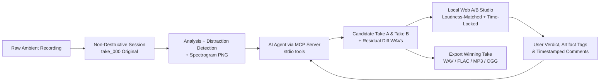

# AmbientSound

**MCP-driven ambient audio cleanup and loudness-matched A/B listening studio.**

AmbientSound is an open-source (`Apache-2.0`) audio restoration toolkit built specifically for **field recordings and ambient soundscapes** (rain, wind, forests, cafés, urban rooms, ocean surf). Unlike speech-only denoisers that treat ambient background texture as noise to be erased, AmbientSound treats the ambient bed as the **desired signal** and targets **localized distractions**—hum, wind rumble, clicks, stray horns, voices, or handling bumps—while keeping the surrounding soundscape natural.

An AI model interacts with AmbientSound over the **Model Context Protocol (MCP)** to inspect psychoacoustic metrics, spectrograms, and detected distraction spans, propose multiple cleanup filter chains (non-destructive *takes*), and spin up **loudness-matched A/B listening tests** in a local Web Audio studio where you choose the winner and leave feedback for the next tuning pass.

---

## Core Workflow



## Key Features (v0.5.2)

- **21 Ambient-First CPU DSP Filters (Streaming & In-Memory, Zero Extra Deps):**
  - `highpass_rumble`: Zero-phase Butterworth high-pass for wind/traffic rumble.
  - `dehum_notch` & `drone_notch`: Zero-phase cascaded notches for 50/60 Hz mains hum and persistent machine-drone frequencies (`30–8000 Hz`).
  - `declick_impulse`: MAD spike detection + PCHIP or Autoregressive (`method="ar"`) gap interpolation, with `spans`, `min_flatness`, and `texture_tick_rate_per_min` guardrails.
  - `declip_from_backup`: Repairs digital/analog clipping from a safety `-12 dB` WAV using GCC-PHAT sub-sample delay alignment, least-squares FIR matching, raised-cosine splices, and AR fallback.
  - `spatial_mix`: Auto/explicit decoding for raw Mid/Side (`ms_decode`, Zoom SSH-6), directional + surround (`dual_mic_blend`, Zoom SGH-6 with GCC-PHAT alignment), mono->stereo decorrelation (`dual_mono_to_stereo`), and L/R tilt/bass-mono balancing (`lr_adjust`).
  - `spectral_denoise`: Linked-stereo soft STFT spectral gate/Wiener denoiser.
  - `spectral_match_suppress`: Excess-capped `n_fft=4096` STFT suppression with `context_gap_s`, `protect_birds` (FM chirp ridges across `300 Hz – 11.5 kHz`), `narrowband_mode` (pinpoint Garmin/watch piezo tones), and `spatial_mode="channel_excess"` (one-sided machinery).
  - `harmonic_track_suppress`: Sweeping `f0(t)` comb tracking for variable-RPM engines and leafblowers, preserving FM birdsong and spatial bed width.
  - `distance_soften`: Attenuates, low-pass airs, smears attacks, or blurs formants (`voice_muffle`, `bark_distance`) so intrusive speech and dogs recede naturally.
  - `bed_shape`: Whole-clip slow-bed comfort polisher (4 s floor warmth tilt, dynamic `2–5 kHz` de-harsh, floor preservation, optional gentle bed width boost) leaving transients & birds untouched.
  - `band_attenuate`: Feathered time-frequency attenuation supporting `"adaptive"`, `"swell"`, `"flat"`, up to `5 s` fades, and multi-span `spans`.
  - `ambience_patch` v3: Non-repeating, event-screened clean donor splicing with `min_donor_distance_s`, `max_donor_crest` knock screening, `loop_count`, `donor_chunks`, and `donor_quality` telemetry.
  - `trim_range`, `cut_regions`, `fade_edges`, `gain`, `parametric_eq`, `soft_compress`, `loudness_normalize`, & `true_peak_limiter`.
- **Outdoor Detection, Pleasantness Telemetry & Do-No-Harm Gate (`analysis.py` / `engines.py`):** Detects `synthetic_beep`, `click_train`, `crackle_burst`, `human_voice`, `dog_bark`, `variable_rpm_engine`, `channel_biased_noise`, and `wind_noise`; scores `sharpness_acum`, `roughness_index`, `ndsi`, `pleasantness_score`, `stereo_layout_hint`, per-band stats (`band_metrics`), `compare_takes` bird retention, and `cleanliness_assessment`.
- **Large-File Streaming, Async Sequence Jobs & A/B Listening Studio (`> 120 s` / 2 GB+):** Background `JobManager` (`start_sequence_job`, `get_job_status`, `cancel_job`, `list_jobs`), slew-normalized `verify_seams`, scrolling `#playheadLine` cursor, `A vs B Diff` spectrograms, `GET /api/jobs`, and nature quality tags.
- **Path-Sandboxed MCP Server (`stdio`, 26 Tools):** Full lifecycle management, compact macro event views (`include_clicks`, `compact_takes`, `take_ids`, parent offsets), gain-normalized `compare_to_take_id` guardrails, single-pass WAV master export + `wait_for_job`, non-overlapping clean ASMR compilation into unified `output_dir`, and strict path allowlisting.

---

## Quickstart

### Prerequisites
- Python 3.11–3.13 (project targets **Python 3.12** via `uv`)
- [`uv`](https://docs.astral.sh/uv/)
- `ffmpeg` on `PATH` (optional for WAV/FLAC; required for MP3/M4A/OGG decode & export)

### 1. Install dependencies
```bash
uv sync --python 3.12 --all-groups
```

### 2. Generate and audition the built-in synthetic demo
```bash
uv run ambient-sound demo
uv run ambient-sound-ui
```
Open the printed URL (for example `http://127.0.0.1:8765/?session=...&ab=...`) in your browser and press:
- `Space` — Play / Pause
- `1` — Candidate A
- `2` — Candidate B
- `3` — Original
- `4` — Removed Residual of active take

### 3. Connect an MCP Client
Configure your MCP host (Claude Desktop, Cursor, Antigravity, etc.) to launch `ambient-sound-mcp` via `uv`:

```json
{
  "mcpServers": {
    "ambient-sound": {
      "command": "uv",
      "args": [
        "--directory",
        "/absolute/path/to/AmbientSound",
        "run",
        "ambient-sound-mcp"
      ],
      "env": {
        "AMBIENTSOUND_ALLOWED_ROOTS": "/absolute/path/to/your/audio/folder"
      }
    }
  }
}
```

> **Tip:** Run `uv run ambient-sound-ui` in a separate terminal while using the MCP server so any `ui_url` returned by `create_ab_test` opens directly in your browser. Both the MCP server and Web UI share `~/.ambientsound` by default (or pass `--workspace <path>` / `AMBIENTSOUND_WORKSPACE` to point them at a custom folder).

---

## Built-In MCP Tools (26 Tools)

| Tool | Purpose |
| :--- | :--- |
| `health_check` | Verifies MCP connectivity, allowed roots, `ffmpeg`/`ffprobe`, and workspace free space. |
| `list_filters` | Returns `filter_count`, `step_schema`, `spans_precedence`, and schemas/defaults for all 21 DSP filters. |
| `create_session` | Ingests (or links in-place via `copy_source=False`) a recording into `take_000` in bounded RAM, archives `events.json`, renders overview PNG, returns compact macro events (`include_clicks`). |
| `list_sessions` | Lists active restoration sessions in the workspace. |
| `get_session_summary` | Returns take DAG, psychoacoustic & pleasantness metrics, bounded macro events (`include_clicks`), `compact_takes`/`take_ids` filtering, and A/B tests. |
| `analyze_take` | Streaming analysis with configurable sensitivity, frequency band gating (`freq_range_hz`), `cleanliness_assessment`, and optional `compare_to_take_id` delta/bird guardrails. |
| `analyze_region` | Analyzes a specific `[start_s, end_s]` window with `cleanliness_assessment`, `band_metrics`, and optional `compare_to_take_id` guardrails. |
| `render_spectrogram` | Generates overview or zoomed `[start_s, end_s]` spectrogram (`n_fft=8192`) and timeline-aligned 3-panel diff PNG. |
| `process_take` | Applies an ordered filter recipe to a parent take, producing an immutable child take with `step_metrics`, `donor_quality`, `seam_padding`, and residual. |
| `create_ab_test` | Registers a timeline-aware, candidate-first (`match_original=False` default) A/B test and returns `ui_url`. |
| `list_ab_tests` | Lists all A/B tests and verdicts in a session. |
| `get_ab_feedback` | Retrieves user verdict, artifact tags, and comments so the AI model can refine the recipe. |
| `delete_take` | Deletes an abandoned non-root take (with optional `cascade=True`) and orphaned A/B tests. |
| `delete_session` | Permanently removes a session folder and all its takes and A/B tests. |
| `export_take` | Exports a chosen take and returns verified size, duration, loudness/true peak, SHA-256, and optional internal audio cleanup (`discard_take_audio=True`). |
| `find_clean_sections` | Ranks largest untouched and minimal-edit stretches in round YouTube ASMR durations (`15 min`–`10 hr`), with optional `round_to_file_local_minutes=True`. |
| `verify_seams` | Measures LUFS delta, `2 s` RMS delta, slew-normalized `sample_step_excess_db`, and `40–8000 Hz` spectral diff across file splits. |
| `calibrate_sequence` | Solves one shared master gain across a continuous split sequence on clean interior slices. |
| `process_sequence` | Single-call seam-padded batch processor for split recordings with outer edge fades, unified `output_dir` master export, optional `compile_clean_targets`, QC, and temp dedup. |
| `start_sequence_job` | Launches `process_sequence` asynchronously in a persistent background worker without client timeouts. |
| `compile_clean_sections` | Splits/stitches ranked clean YouTube ASMR stretches (with optional `distinct_regions=True`, full masters/combined output) into `output_dir` with full manifest metadata and auto-RF64 > 3.8 GB. |
| `start_compile_clean_sections_job` | Launches `compile_clean_sections` asynchronously in the background with byte/frame progress heartbeats and `output_dir` locking. |
| `get_job_status` | Polls progress (`progress_pct`, `item_progress_pct`, `phase`, `eta_s`), `items_summary`, or final result of a background job. |
| `wait_for_job` | Blocks server-side up to `55 s` for a background job to progress or finish without requiring client shell sleeps. |
| `cancel_job` | Requests cooperative cancellation of a queued or running background sequence job. |
| `list_jobs` | Lists recent background jobs persisted under `<workspace>/jobs` (compact summaries by default). |

---

## Documentation Index

- [Agent MCP Usage Instructions](instructions.md) — standalone handover guide for AI models operating this MCP server
- [Architecture & Data Model](docs/ARCHITECTURE.md)
- [Ambient Audio Gaps & Design Decisions](docs/GAPS_AND_DESIGN.md)
- [Open-Source License Compatibility Analysis](docs/LICENSES.md)
- [Ecosystem & Model Research](docs/RESEARCH.md)
- [Roadmap](docs/ROADMAP.md)
- [Project Memory (Decisions & Invariants)](docs/MEMORY.md)
- [Engineering & DSP Tuning Notes](docs/NOTES.md)
- [Changelog](CHANGELOG.md)
- [Contributing](CONTRIBUTING.md)

---

## License

Licensed under the **Apache License, Version 2.0**. See [LICENSE](LICENSE) and [NOTICE](NOTICE).
