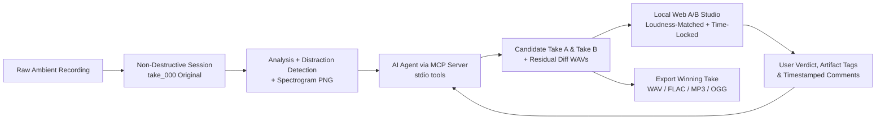

# AmbientSound

**MCP-driven ambient audio cleanup and loudness-matched A/B listening studio.**

AmbientSound is an open-source (`Apache-2.0`) audio restoration toolkit built specifically for **field recordings and ambient soundscapes** (rain, wind, forests, cafés, urban rooms, ocean surf). Unlike speech-only denoisers that treat ambient background texture as noise to be erased, AmbientSound treats the ambient bed as the **desired signal** and targets **localized distractions**—hum, wind rumble, clicks, stray horns, voices, or handling bumps—while keeping the surrounding soundscape natural.

An AI model interacts with AmbientSound over the **Model Context Protocol (MCP)** to inspect psychoacoustic metrics, spectrograms, and detected distraction spans, propose multiple cleanup filter chains (non-destructive *takes*), and spin up **loudness-matched A/B listening tests** in a local Web Audio studio where you choose the winner and leave feedback for the next tuning pass.

---

## Core Workflow



## Key Features (v0.1.0)

- **Ambient-First DSP Filters (CPU-only, pure permissive stack):**
  - `highpass_rumble`: Zero-phase Butterworth high-pass for wind/handling rumble.
  - `dehum_notch`: Zero-phase cascaded IIR notch filter for 50/60 Hz mains hum and harmonics.
  - `declick_impulse`: MAD spike detection + cubic/linear sample interpolation for clicks/pops.
  - `spectral_denoise`: Linked-stereo soft STFT spectral gate/Wiener denoiser.
  - `band_attenuate`: Time- and frequency-localized feathered STFT attenuation (cars, sirens, distant voices, tonal whines).
  - `ambience_patch`: Replaces a distracted span with matched clean room-tone / ambient texture from elsewhere in the recording using equal-power crossfades.
  - `parametric_eq`: RBJ biquad peaking, low-shelf, and high-shelf tone shaping.
  - `loudness_normalize`: Integrated LUFS normalization with true-peak ceiling protection.
- **Non-Destructive Take DAG:** Every processing pass writes an immutable `take_NNN` (`audio.wav` in 32-bit float, `residual.wav` showing *only* what was removed, `recipe.json`, `spectrogram.png`, and `diff_spectrogram.png`).
- **Bias-Free Local A/B Listening Studio:**
  - Time-locked synchronized Web Audio playback across Original, Take A, Take B, and Removed Residuals (`1`/`2`/`3`/`4` hotkeys, `12 ms` click-free crossfades).
  - Attenuation-only LUFS loudness matching (`<= 0 dB` gain offsets so louder never sounds "better" and playback never clips).
  - Loop focus spans for surgical inspection of short distractions.
  - Optional Blind Mode that hides take names and filter recipes until after you submit a verdict.
  - Structured artifact tags (`Natural ambience`, `Metallic / swishy`, `Hollow gap`, etc.) and freeform comments logged for the MCP agent to read on the next iteration.
- **Path-Sandboxed MCP Server (`stdio`):** Clean JSON responses, finite-number guarantees, and strict path allowlisting.

---

## Quickstart

### Prerequisites
- Python 3.11–3.13 (project targets **Python 3.12** via `uv`)
- [`uv`](https://docs.astral.sh/uv/)
- `ffmpeg` on `PATH` (optional for WAV/FLAC; required for MP3/M4A/OGG decode & export)

### 1. Install dependencies
```bash
uv sync --python 3.12 --all-groups
```

### 2. Generate and audition the built-in synthetic demo
```bash
uv run ambient-sound demo
uv run ambient-sound-ui
```
Open the printed URL (for example `http://127.0.0.1:8765/?session=...&ab=...`) in your browser and press:
- `Space` — Play / Pause
- `1` — Candidate A
- `2` — Candidate B
- `3` — Original
- `4` — Removed Residual of active take

### 3. Connect an MCP Client
Configure your MCP host (Claude Desktop, Cursor, Antigravity, etc.) to launch `ambient-sound-mcp` via `uv`:

```json
{
  "mcpServers": {
    "ambient-sound": {
      "command": "uv",
      "args": [
        "--directory",
        "/absolute/path/to/AmbientSound",
        "run",
        "ambient-sound-mcp"
      ],
      "env": {
        "AMBIENTSOUND_ALLOWED_ROOTS": "/absolute/path/to/your/audio/folder"
      }
    }
  }
}
```

> **Tip:** Run `uv run ambient-sound-ui` in a separate terminal while using the MCP server so any `ui_url` returned by `create_ab_test` opens directly in your browser.

---

## Built-In MCP Tools

| Tool | Purpose |
| :--- | :--- |
| `list_filters` | Returns machine-readable schemas, defaults, and tuning hints for all DSP filters. |
| `create_session` | Ingests a recording into `take_000`, analyzes metrics & distractions, renders spectrogram. |
| `list_sessions` | Lists active restoration sessions in the workspace. |
| `get_session_summary` | Returns full take tree, metrics, and A/B test history for a session. |
| `analyze_take` | Computes or retrieves loudness, stereo correlation, spectral stats, and distraction spans. |
| `render_spectrogram` | Generates waveform + spectrogram PNG and optional 3-panel before/after/residual diff PNG. |
| `process_take` | Applies an ordered filter recipe to a parent take, producing an immutable child take + residual. |
| `create_ab_test` | Registers a loudness-matched (or blind) A/B comparison and returns a ready-to-open `ui_url`. |
| `list_ab_tests` | Lists all A/B tests and verdicts in a session. |
| `get_ab_feedback` | Retrieves user verdict, artifact tags, and comments so the AI model can refine the recipe. |
| `export_take` | Exports a chosen take to WAV, FLAC, MP3, or OGG inside allowed roots. |

---

## Documentation Index

- [Agent MCP Usage Instructions](instructions.md) — standalone handover guide for AI models operating this MCP server
- [Architecture & Data Model](docs/ARCHITECTURE.md)
- [Ambient Audio Gaps & Design Decisions](docs/GAPS_AND_DESIGN.md)
- [Open-Source License Compatibility Analysis](docs/LICENSES.md)
- [Ecosystem & Model Research](docs/RESEARCH.md)
- [Roadmap](docs/ROADMAP.md)
- [Project Memory (Decisions & Invariants)](docs/MEMORY.md)
- [Engineering & DSP Tuning Notes](docs/NOTES.md)
- [Changelog](CHANGELOG.md)
- [Contributing](CONTRIBUTING.md)

---

## License

Licensed under the **Apache License, Version 2.0**. See [LICENSE](LICENSE) and [NOTICE](NOTICE).
