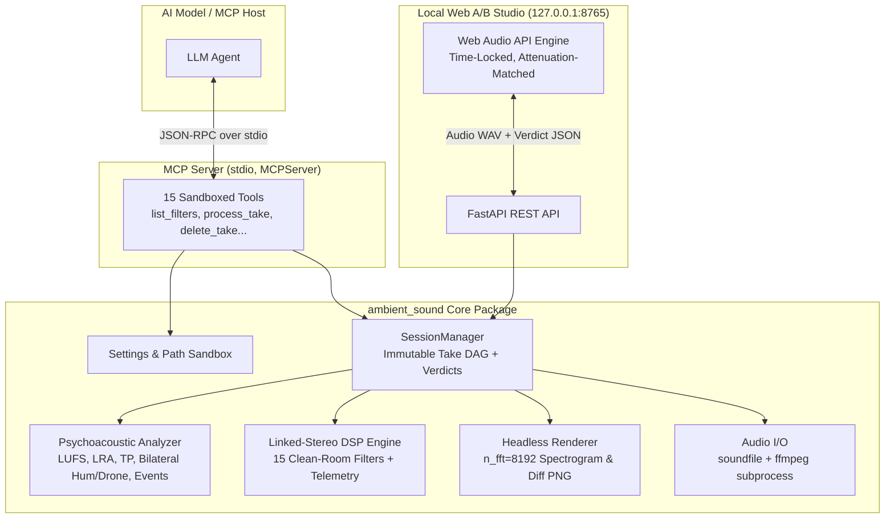

# Architecture & Data Model

**AmbientSound** separates **non-destructive state**, **DSP processing**, **model interface (MCP)**, and **human auditioning (Web A/B Studio)** into cleanly decoupled layers.

---

## 1. System Topology



---

## 2. Internal Audio Invariants

1. **Canonical Tensor Shape:** Every internal audio array loaded or passed between `io_audio`, `analysis`, `dsp`, and `visuals` is a 2D `numpy.ndarray` of `dtype=np.float64` with shape `(num_samples, num_channels)`.
   - Mono files become `(num_samples, 1)`.
   - Stereo files stay `(num_samples, 2)`.
2. **Exact Length Preservation (Restoration Filters):** Non-structural DSP filters preserve exact sample count `num_samples` and channel count `num_channels` so any processed take `T` can be subtracted sample-for-sample from its parent `P`:
   $$\text{residual} = P - T$$
   Length-changing editing filters (`trim_range`, `cut_regions`) intentionally create a shortened timeline without a full-track residual.
3. **Storage & Streaming Threshold (`STREAMING_THRESHOLD_S = 120.0 s`):**
   - Takes `<= 120 s` run in memory and store 32-bit float WAV (`FLOAT`) + materialized `residual.wav`.
   - Takes `> 120 s` (such as 1-hour / 672 MB field recordings) stream chunk-by-chunk on disk (`apply_recipe_streaming`, `analyze_file`, `StreamingLUFS`, `chunked_true_peak_linear`), store 24-bit WAV (`PCM_24`), and compute sliced residuals dynamically for the Web UI.
4. **Finite JSON Guarantee:** Metrics such as integrated LUFS (on `<0.45 s` or silent clips) or stereo correlation (on silent/constant channels) are sanitized through `_finite_or_none` so `NaN` or `±inf` never enter JSON responses.

---

## 3. Session Workspace Layout

Every workspace lives under `AMBIENTSOUND_WORKSPACE` (default `~/.ambientsound/`):

```text
~/.ambientsound/
  sessions/
    <session_id>/
      session.json               # Canonical SessionSummary (takes + A/B tests)
      session_feedback_log.md    # Append-only human verdict & comment log
      takes/
        take_000/                # Immutable source recording
          audio.wav
          events.json            # Full event log (inline capped <=200 in session.json)
          spectrogram.png
        take_001/                # Processed child take
          audio.wav
          residual.wav           # parent_audio - audio (<=120 s non-structural takes)
          events.json
          recipe.json            # parent_take_id + ordered FilterStep list
          spectrogram.png
          diff_spectrogram.png   # 3-panel Before / After / Gain-Matched Residual
      ab_tests/
        ab_001.json              # ABTestRecord + attenuation-only LUFS offsets + verdict
```

---

## 4. Loudness-Matched Time-Locked A/B Engine

Human listening perception strongly favors whichever clip sounds louder, even by `0.5 dB`. To prevent loudness bias while keeping mastered comparisons audible:

1. **Candidate-First Attenuation-Only Gains (`match_original=False` default):**
   - `original_take_id` auto-resolves to the earliest common ancestor matching both `take_a` and `take_b`'s timeline (`source_offset_s`, `timeline_modified`, duration)—so trimmed `trim_range` previews compare cleanly against the uncleaned preview snippet rather than `take_000` at wrong timestamps.
   - By default (`match_original=False`), target loudness matches across candidates:
     $$L_{\text{target}} = \min(L_A, L_B)$$
     $$g_i = \min(0.0,\; L_{\text{target}} - L_i)\ \text{dB}$$
     so `-14 LUFS` mastered takes stay loud instead of being pulled `-35 dB` down to a quiet `-49 LUFS` original (`match_original=True` includes $L_{\text{orig}}$ when needed). Because $g_i \le 0.0\ \text{dB}$, loudness matching **never boosts** into clipping.
   - When computing A/B Removed Residuals (`load_take_residual_slice`) or 3-panel diff spectrograms, takes differing by `> 1.5 dB` RMS are gain-scaled before subtraction so mastering gain never hides true spectral removals.
2. **Browser Synchronized Playback:**
   - The browser decodes `Original`, `Take A`, `Take B`, `Residual A`, and `Residual B` into `AudioBuffer`s upfront.
   - Pressing Play schedules all `AudioBufferSourceNode`s at the exact same `AudioContext.currentTime` offset, feeding dedicated `GainNode`s.
   - Switching between A / B / Original / Residual ramps gains over `12 ms` (`linearRampToValueAtTime`), avoiding clicks while staying completely sample-locked.
   - Optional loop region (`focus_start_s..focus_end_s`) lets the listener repeatedly inspect the exact second where a distraction was cleaned.
